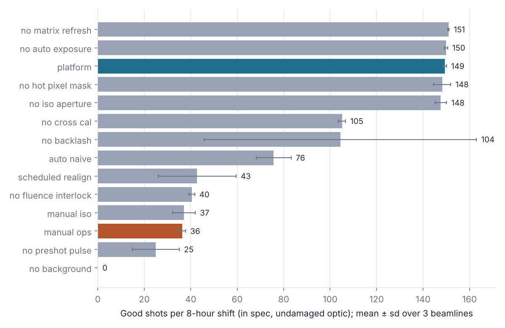

# laser-beamline-platform

**A greenfield software platform for a laser team, built and tested against a simulated beamline. It covers
device drivers for the controllers, cameras and energy meters; ISO 11146 beam diagnostics in C++; automated
alignment and calibration; a shot sequencer whose interlocks predict the fluence on the optics; experimental
data in HDF5 and SQLite; DDS, REST and webhooks; and an operator console.**


A laser team's day has the same problems every shift. The table drifts, so someone realigns two mirrors by hand
while watching camera screens. Mounts lose motion when they change direction. Cameras have hot pixels and
background light. The energy meter slowly loses sensitivity. Now and then dust on an optic makes a hot spot that
the next full-energy shot burns in, and that damage site grows with every later shot. This repository is the
software that takes over those jobs and records why it did each thing. Because the laser it targets does not
exist yet, it is tested against a simulated beamline with a hidden truth. Every design is scored on the same
luck: the same drift, the same hot spots, the same shot-to-shot jitter.

## Results

<!-- results:start -->

Dev campaign: 12 simulated shifts of 8 hours on each of 3 beamlines (seeds 11, 12, 13), every design on the same luck. Mean ± standard deviation across beamlines. Generated by `python3 -m evals.run` from `reports/dev.json`.

| Design | Good shots / day | In spec | Far-field error p95 | Near-field error p95 | Energy reading error p95 | Damaging shots | Shots held while safe | Alignment min / day |
|---|---:|---:|---:|---:|---:|---:|---:|---:|
| Status quo: manual alignment, raw-frame centroid | 36 ± 2 | 27.6 ± 1.4 % | 8.8 ± 0.2 µrad | 1.13 ± 0.12 mm | 4.11 ± 0.01 % | 190 ± 28 | 0 | 35 ± 3 |
| Manual alignment on ISO 11146 diagnostics | 37 ± 5 | 28.1 ± 3.8 % | 8.7 ± 0.3 µrad | 1.28 ± 0.09 mm | 4.14 ± 0.03 % | 192 ± 31 | 0 | 35 ± 2 |
| Scripted automation, raw-frame centroid | 76 ± 8 | 54.8 ± 4.1 % | 11.2 ± 5.5 µrad | 0.66 ± 0.04 mm | 4.15 ± 0.03 % | 2 | 0 | 5 ± 0 |
| **The platform** | 149 ± 1 | 98.3 ± 0.1 % | 3.5 ± 0.1 µrad | 0.40 ± 0.01 mm | 1.25 ± 0.17 % | 0 | 0 | 12 ± 2 |

A good shot is inside the experiment's spec: pointing within 5 µrad, centred within 0.75 mm on the amplifier aperture, energy within 3 % of target, on an undamaged optic. A damaging shot exceeds the optic's damage fluence (3 J/cm²); without a fluence check, every later shot through the damage site damages it further.

**Ablations** (dev, mean over beamlines): the platform with one capability switched off.

| The platform without | What it does | Good shots / day | In spec | Damaging shots | Main reason a shot was held |
|---|---|---:|---:|---:|---|
| no background | No dark frame or baseline subtraction | 0 (-149) | 0.0 % | 0 | alignment did not converge 3 times in a row |
| no hot pixel mask | Hot pixels left in the frame | 148 (-1) | 98.4 % | 0 | predicted peak fluence 3.06 J/cm2 above limit 2.25 J/cm2 |
| no iso aperture | Moments over the whole frame instead of the ISO integration area | 148 (-2) | 98.3 % | 0 | predicted peak fluence 3.04 J/cm2 above limit 2.25 J/cm2 |
| no auto exposure | Fixed camera exposure | 150 (+0) | 98.4 % | 0 | predicted peak fluence 2.74 J/cm2 above limit 2.25 J/cm2 |
| no backlash | Actuator moves without backlash compensation | 104 (-45) | 97.9 % | 0 | alignment did not converge 3 times in a row |
| no matrix refresh | The interaction matrix is measured once and never refreshed | 151 (+2) | 98.6 % | 0 | predicted peak fluence 3.06 J/cm2 above limit 2.25 J/cm2 |
| scheduled realign | Realign every 30 shots instead of on the pre-shot measurement | 43 (-107) | 84.4 % | 0 | pre-shot error at 1.20 of tolerance after alignment |
| no preshot pulse | Decide from the previous shot instead of a pre-shot low-energy pulse | 25 (-124) | 17.5 % | 4 | predicted peak fluence 3.71 J/cm2 above limit 2.25 J/cm2 |
| no fluence interlock | Energy limit only, no fluence prediction | 40 (-109) | 26.1 % | 1379 | pre-shot error at 7.11 of tolerance after alignment |
| no cross cal | The energy meter keeps its vendor factor | 105 (-44) | 67.7 % | 0 | predicted peak fluence 3.06 J/cm2 above limit 2.25 J/cm2 |

**Release gates** (config/gates.toml), applied to the platform:

| Gate | Rule | Dev (worst seed) | Held-out |
|---|---|---:|---:|
| damage events | ≤ 0 | 0.000 pass | 0.000 pass |
| in spec share | ≥ 0.95 | 0.982 pass | 0.953 pass |
| ff error p95 urad | ≤ 5.0 | 3.515 pass | 4.071 pass |
| energy report error p95 | ≤ 0.015 | 0.014 pass | 0.018 **FAIL** |
| false block share | ≤ 0.02 | 0.000 pass | 0.000 pass |
| good shots per day vs manual | ≥ 1.5 | 4.115 pass | 0.570 **FAIL** |

**Held-out campaign** (14 shifts, run once at commit `2bc0686` behind `reports/heldout.lock`; different mounts, more backlash, an actuator that wears on day 6, a camera that resets its gain on day 9, a reference meter whose certificate expires on day 11, hot spots on days 2 and 10):

| Design | Good shots / day | In spec | Far-field error p95 | Near-field error p95 | Energy reading error p95 | Damaging shots | Shots held while safe | Alignment min / day |
|---|---:|---:|---:|---:|---:|---:|---:|---:|
| Status quo: manual alignment, raw-frame centroid | 20 | 16.0 % | 9.3 µrad | 1.14 mm | 6.80 % | 172 | 0 | 52 |
| Manual alignment on ISO 11146 diagnostics | 20 | 17.0 % | 10.3 µrad | 1.15 mm | 6.82 % | 66 | 0 | 89 |
| Scripted automation, raw-frame centroid | 15 | 31.6 % | 2709.1 µrad | 0.87 mm | 6.33 % | 0 | 0 | 4 |
| **The platform** | 12 | 95.3 % | 4.1 µrad | 0.41 mm | 1.75 % | 0 | 0 | 6 |

**Beam analysis engines** (`scripts/bench.py`; identical results, checked by a property test on random frames):

| Frame | NumPy reference | C++ beamcore | Speed-up |
|---|---:|---:|---:|
| 128 x 128 | 0.52 ms | 0.15 ms | 3.4× |
| 512 x 512 | 7.29 ms | 3.01 ms | 2.4× |
| 1024 x 1024 | 30.71 ms | 14.21 ms | 2.2× |
| 2048 x 2048 | 136.62 ms | 52.11 ms | 2.6× |

**Logbook handover check** (`python3 -m evals.elog_eval`): 8 of 8 correct drafts posted; 186 of 200 drafts with a planted wrong number or shot id stopped (count 39/52, decimal 51/51, other day 50/51, shot id 46/46).

<!-- results:end -->




## What it does

| Area | What is here |
|---|---|
| **Device layer** | Drivers for a four-axis picomotor controller (ASCII), the laser control unit, two SCPI energy meters and two 12-bit cameras (binary frames with CRC-32). They work over TCP or an in-memory loopback that carries the same bytes. Only safe-to-repeat requests are retried. A move is confirmed against the controller's step counter. A FIRE command is never repeated after a lost reply. Device health counts failures and CRC retries, and a faulted device holds the shots. ([docs/icd/devices.md](docs/icd/devices.md)) |
| **Diagnostics** | ISO 11146 beam analysis: dark frame and border baseline, hot-pixel map (median absolute deviation against the local background), iterated integration area of three beam widths, D4σ widths, a 3×3 peak, saturation that ignores isolated hot pixels. It is written in C++20 (`cpp/beamcore`, pybind11) and as a NumPy reference, kept identical by a property test on random frames. |
| **Calibration** | The interaction matrix is measured on the beamline: per-axis pokes give the pointing rows, backlash and the reverse/forward step ratio, and centring walks give the near-field rows. Alignment uses damped least squares weighted by the tolerances and shortens any step that could push the spot off a camera. It backs off a move that loses the beam, refreshes the matrix after repeated mismatch, detects a stuck actuator, enforces a soft travel limit, and faults after repeated non-convergence. Exposure control and dark frames run every shift. Energy-meter cross-calibration uses a reference with a certificate, an uncertainty budget (k = 2) and drift extrapolation. ([ADR 3](docs/adr/0003-measure-the-mechanics-before-steering.md), [ADR 5](docs/adr/0005-energy-traceable-to-a-reference.md)) |
| **Shot sequencer and interlocks** | Each shot starts with a pre-shot pulse at about 1/1000 of full energy. The platform realigns on condition, then asks the interlocks. They predict the peak fluence from the measured near-field profile and the target energy, and they check device faults, alignment faults, a beam off the cameras, a pre-shot error beyond tolerance, saturation and the diode temperature. Shots above 8 J carry a second person's confirmation. Every decision is stored with its inputs. ([ADR 4](docs/adr/0004-the-pre-shot-pulse-and-the-fluence-interlock.md)) |
| **Data** | Shot records go to SQLite and are written once: the same record again is a no-op, a different one is refused. Each record carries the ids of the camera, matrix and energy calibrations behind its numbers. Frames go to HDF5, chunked and gzip-compressed, one file per shift. |
| **Interfaces** | DDS topics on Eclipse Cyclone DDS (shots, interlock state as transient-local, alignments, alerts, health); a FastAPI service with Server-Sent Events; webhooks with HMAC-SHA256 signatures, replay window, retries with backoff and event ids for deduplication. ([docs/icd/dds.md](docs/icd/dds.md), [docs/icd/http.md](docs/icd/http.md)) |
| **Logbook agent** | At the end of a shift, a model drafts the handover note (with `ANTHROPIC_API_KEY` set; a template otherwise) from facts the data store can prove. Code checks every number and shot id before the note posts. ([ADR 6](docs/adr/0006-the-model-drafts-code-checks-the-logbook.md)) |
| **Operator console** | React, TypeScript and Framer Motion. Three views: the beamline with device health; the interlock state with every held shot and its reasons; and camera frames with the reference, tolerance and measured D4σ ellipse, the shift's pointing, the calibration history and the evaluation. Each view has loading, error-with-retry and empty states. |

## How it works

```
                 config/world.toml (truth)                          config/platform.toml, designs.toml
 world/beamline.py ── mirrors, drift, cameras, meters, hot spots, damage
        │
 world/emulators.py ── the devices as they look on the wire (ASCII, SCPI, binary frames)
        │  loopback or TCP (world/servers.py)
 lbp/devices ── drivers: retry what is safe, confirm moves, never re-fire, CRC, health
        │
 lbp/diagnostics ── ISO 11146 (C++ beamcore = NumPy reference)
 lbp/calibration ── dark + hot pixels, exposure, interaction matrix + backlash, alignment, energy cross-cal
 lbp/control     ── shift: dark frames, cross-cal when due, matrix, align
                    shot: pre-shot pulse → realign on condition → interlocks → fire → measure → store
 lbp/data        ── SQLite shots/decisions/calibrations, HDF5 frames
 lbp/bus, lbp/api ── DDS topics, REST + SSE, signed webhooks ──► web/ operator console
 lbp/elog        ── handover draft (model or template) → number check → logbook
        │
 evals/ ── operate designs on the same luck, score against the truth, gates, held-out once, README
```

## Limits: what is simulated, and what failed

- **The held-out beamline exposed a robustness gap.** The platform stayed safe there: no damaging shot (the
  status quo fired 172) and 95 % of fired shots in spec. But a false stuck-actuator fault, the soft travel
  limit, and no search for a beam that starts the shift off camera made it hold most shots. It delivered
  11.6 good shots per shift against the status quo's 20.4, and two gates failed. The causes and the fixes are
  in [docs/heldout.md](docs/heldout.md). They are not applied, because the held-out run is only used once.

- **The beamline is simulated.** That covers the mirror geometry, step sizes and backlash, drift and warm-up,
  the cameras' noise and defects, the meters' drift, hot spots and damage growth. The numbers are chosen to be
  plausible, not measured on Focused Energy's lasers. The platform never reads the simulation's state, but its
  tuning (tolerances, the realignment threshold, step caps) was set on the dev beamlines.
- **The devices are emulators.** They speak documented, realistic protocols, not any vendor's exact command
  set. A real controller needs a driver adapted to its manual, with the same safety rules.
- **One laser chain, two mirrors, two cameras.** No timing system, no PLC or SCADA interface (DDS and REST are
  the integration points here), no multi-beam coordination.
- **The status quo is a model of manual operation.** An operator aligns by eye on the camera screens with the
  commissioning matrix and checks the optics every morning. Real teams differ.
- **Some ablations have no measurable effect on the dev beamlines.** Exposure control, the matrix refresh and
  the hot-pixel map barely change the dev numbers; the held-out beamline (camera gain reset, actuator wear) is
  where they are tested. Without dark-frame subtraction the far-field spot cannot be measured at all, so that
  ablation fires nothing.
- **No model ran in this build.** The handover evaluation measures the checker on template drafts with planted
  errors. A wrong number that happens to equal another fact of the same shift passes the check; that is the
  main miss in the table above.

## Run it

```bash
pip install -r requirements.txt
cmake -S . -B build -DCMAKE_BUILD_TYPE=Release && cmake --build build -j   # beamcore + its tests + the Python module
scripts/check.sh                    # C++ tests, lint, Python tests, README check
python3 -m evals.run --days 3       # every design on the dev beamlines for three shifts
python3 -m evals.run                # the full dev campaign -> reports/dev.json
python3 -m evals.readme             # regenerate the results above

cd web && npm ci && npm run dev     # the console, on data from python3 -m evals.console_data
```

Repository rules for people and coding agents: [AGENTS.md](AGENTS.md). Repeatable tasks: [SKILLS.md](SKILLS.md).
Decisions: [docs/adr](docs/adr). Held-out notes: [docs/heldout.md](docs/heldout.md).
